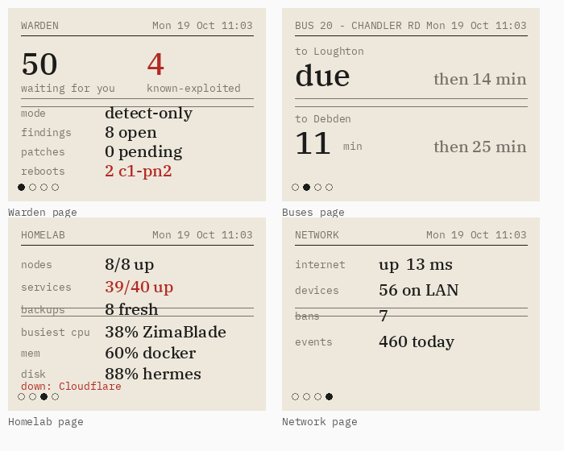
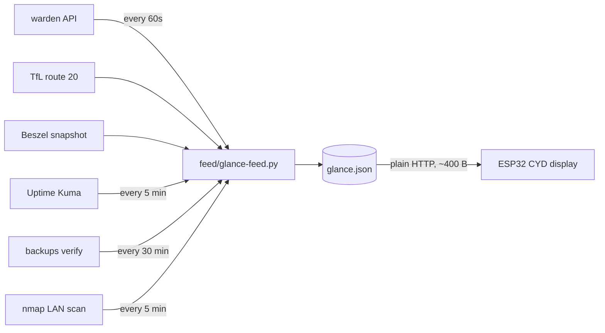

# homelab-glance

A desk display for the homelab: an **ESP32-2432S028R ("Cheap Yellow Display", CYD)**,
2.8" 320×240 with touch, styled like e-ink (paper, black ink, one red ink, serif numbers, dim backlight).



*Pages rendered with the real board colour layout and the feed data captured on 2026-10-19.*

## What it does

- **Tap to flip four pages** — Warden, Buses, Homelab, Network — each showing a different slice of the homelab.
- **Warden page:** items "waiting for you", known-exploited CVEs (red when > 0), mode, open findings, hot hosts, pending patches and reboots.
- **Buses page:** next TfL route 20 from Main Street each way (to town / to station), counting down.
- **Homelab page:** nodes up (Beszel) · services up (Uptime Kuma) · backups fresh · busiest CPU / RAM / disk · what is down.
- **Network page:** internet up + latency · devices on the LAN · CrowdSec bans · warden events today.
- **Safe by design:** no tokens live on the board; a failing source drops off its page instead of breaking the feed.

## Screenshots / demo

The screen makes one plain-HTTP request on the LAN (`http://192.0.2.40:8798/glance.json`,
~400 bytes) every 30 seconds. Hermes does the slow work (TLS, logins, scans) in `feed/glance-feed.py`;
the board only redraws when the data changes, plus once a minute for the bus countdown.
The four pages above are drawn exactly as the board draws them, from the feed captured on 2026-10-19.

## Quick start

Prerequisites:

- Python 3 and `esphome` (install into a venv, see below)
- A CYD board (ESP32-2432S028R) and a micro-USB cable for the first flash
- A GitHub clone of this repo

From a fresh clone:

```bash
python3 -m venv ~/esphome-venv && source ~/esphome-venv/bin/activate && pip install esphome
gh repo clone casareanderson/homelab-glance && cd homelab-glance
cp secrets.yaml.example secrets.yaml      # fill in wifi_ssid + wifi_password
esphome run glance-home.yaml              # USB the first time, WiFi (OTA) after that
```

`secrets.yaml` is gitignored. On first boot the board opens a hotspot called **homelab-glance setup**
so you can pick your network from your phone, then fetches its feed. Success looks like the four
pages rendering with live numbers and a clock in the top-right corner.

## Usage

The common flows:

```bash
# Build and flash with WiFi baked in (no on-device setup)
esphome run glance-home.yaml

# Flash the same build, letting the board's hotspot configure WiFi
esphome run glance-flash.yaml

# Different display variant (see Configuration) or inverted colours
esphome -s display_model ESP32-2432S028 run glance-flash.yaml
esphome -s invert_colors true run glance-home.yaml

# Serve the feed board-side (Hermes): timer runs glance-feed.py every 60 s,
# glance-feed-http binds to 192.0.2.40:8798 and serves only /var/lib/glance-feed
```

On the board page (`http://homelab-glance.local`) you get a backlight slider and live logs.
`feed/glance-feed.py` gathers everything each minute and the HTTP service lets the board
pull one small JSON over the LAN.

## Configuration

`glance-home.yaml` and `glance-flash.yaml` are ESPHome builds. Secrets live in `secrets.yaml`
(gitignored, copied from `secrets.yaml.example`) and are read as ESPHome `!secret` values.
`feed/glance-feed.py` reads environment and configuration at run time.

| Key / variable | Where | Default | Purpose |
|---|---|---|---|
| `wifi_ssid` | `secrets.yaml` | — | Network SSID for `glance-home.yaml` |
| `wifi_password` | `secrets.yaml` | — | Network password |
| `api_key` / `ota_password` | `secrets.yaml` | — | Only the older `glance.yaml` (Home Assistant) build |
| `WARDEN_TOKEN` | env (`feed/glance-feed.py`) | read from `/root/.hermes/profiles/sec/.env` | Bearer token for warden's API (never on the board) |
| `feed_url` | substitution in `glance-flash.yaml` | `http://192.0.2.40:8798/glance.json` | Where the board fetches the feed |
| `display_model` | substitution | `ESP32-2432S028-7789` | Board preset: `ESP32-2432S028-7789`, `-9342` or `ESP32-2432S028` |
| `invert_colors` | substitution | `false` | `true` if paper looks dark or colours look negative |
| `bus_header`, `bus_label_a`, `bus_label_b` | substitutions | `BUS 20 - MAIN ST`, `to town`, `to station` | Buses page labels |
| bus stop IDs | constant at top of `feed/glance-feed.py` | `YOUR_STOP_A` / `YOUR_STOP_B` | TfL stop references for each direction |

## How it works

```
warden, TfL, Beszel, Kuma, backups, nmap ──> glance-feed (Hermes, every 60 s) ──> glance.json ──> board (every 30 s)
```



Hermes does all the slow work (TLS, logins, scans), so the board never blocks, which was what
tripped the ESP's 5-second watchdog and made it restart and blink. Slow sources are cached
(Kuma and the LAN scan every 5 minutes, backups every 30 minutes), and a failing source returns
`null` instead of breaking the feed. The display uses ESPHome's `mipi_spi` driver, which draws in
strips (~20 KB buffer) because a full 320×240 16-bit frame (150 KB) does not fit in this
PSRAM-less ESP32's RAM.

Project structure:

```
homelab-glance/
├── glance-flash.yaml      # reference ESPHome build (hotspot setup, all pages)
├── glance-home.yaml       # WiFi baked in at build time (packages glance-flash.yaml)
├── glance.yaml            # older Home-Assistant-driven build
├── secrets.yaml.example   # template for secrets.yaml (gitignored)
├── feed/
│   ├── glance-feed.py     # gathers facts each minute -> glance.json
│   ├── glance-feed.service / .timer   # systemd timer (every 60 s)
│   └── glance-feed-http.service       # LAN HTTP server on 192.0.2.40:8798
├── ha/warden-glance-sensors.yaml      # Home Assistant sensors for the older build
└── docs/display-pages.png             # rendering of the real feed, 2026-10-19
```

## Status, limits and real results

From the live feed captured on 2026-10-19 (a real run of `feed/glance-feed.py`):

- **Warden:** 50 approvals waiting, 4 known-exploited CVEs, mode `detect-only`, 8 open findings, 1 hot host, 7 CrowdSec bans, 461 events in 24 h.
- **Buses:** route 20 from Main Street — next in ~1 min toward town, next in ~4 min toward station; back to back after each.
- **Homelab:** 8/8 Beszel nodes up; 39/40 monitors up (one down: Cloudflare); 8 backups fresh, 0 stale, 0 missing; busiest CPU NAS 37%, RAM Node 1 61%, disk agents 88%.
- **Network:** internet up, 14 ms, 0% packet loss; 56 devices on the LAN.

Known limits and non-goals:

- Full-screen display buffer does not fit in this ESP32's RAM; the `mipi_spi` strip buffer is used instead.
- **AdGuard stats are not shown** — the GL.iNet build ties its API to the router UI session (returns 401).
- **NetBird peers are not shown** — it only counts peers with a live tunnel, so a partial "1/9" could read like an outage.
- **OTA has no password** — keep the display on the trusted LAN only.
- **Metrics above are point-in-time** from the dated feed, not a rolling benchmark; the display shows live numbers every 30 seconds.

## Licence and credits

AGPL-3.0 · part of the C1 Lab homelab. Bus data © Transport for London (TfL), used under
their open-data terms. Display fonts are the Google Fonts `Libre Baskerville`, `IBM Plex Mono`
and (older build) `Roboto`, rendered by ESPHome's `gfonts://` provider.